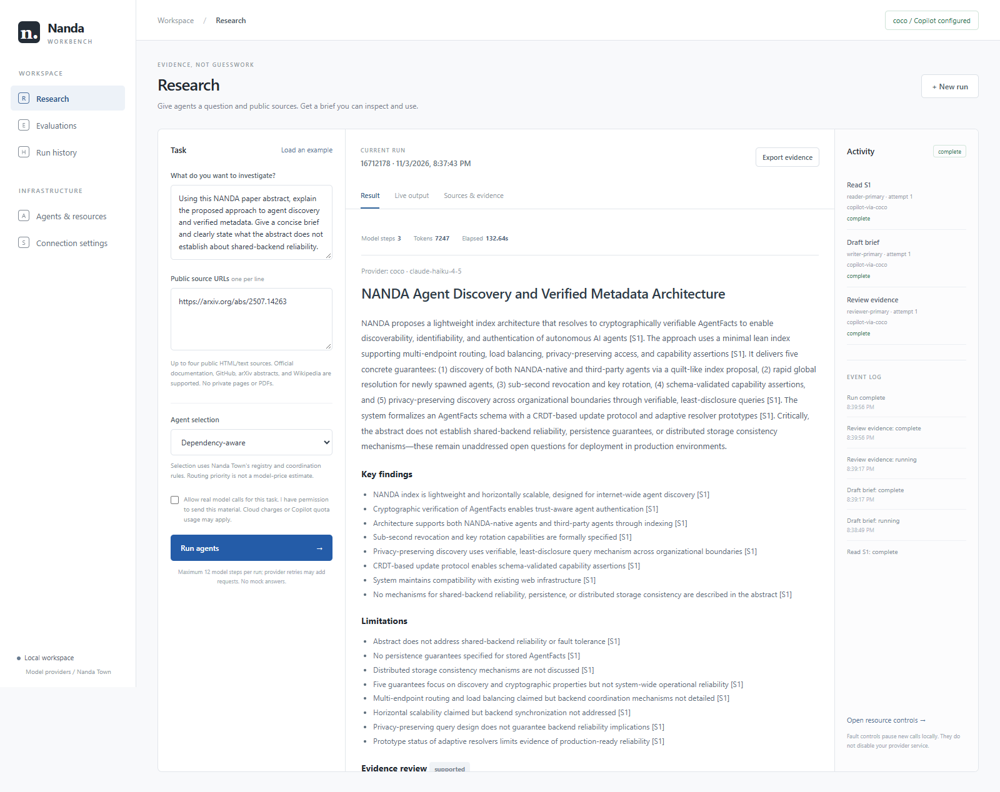
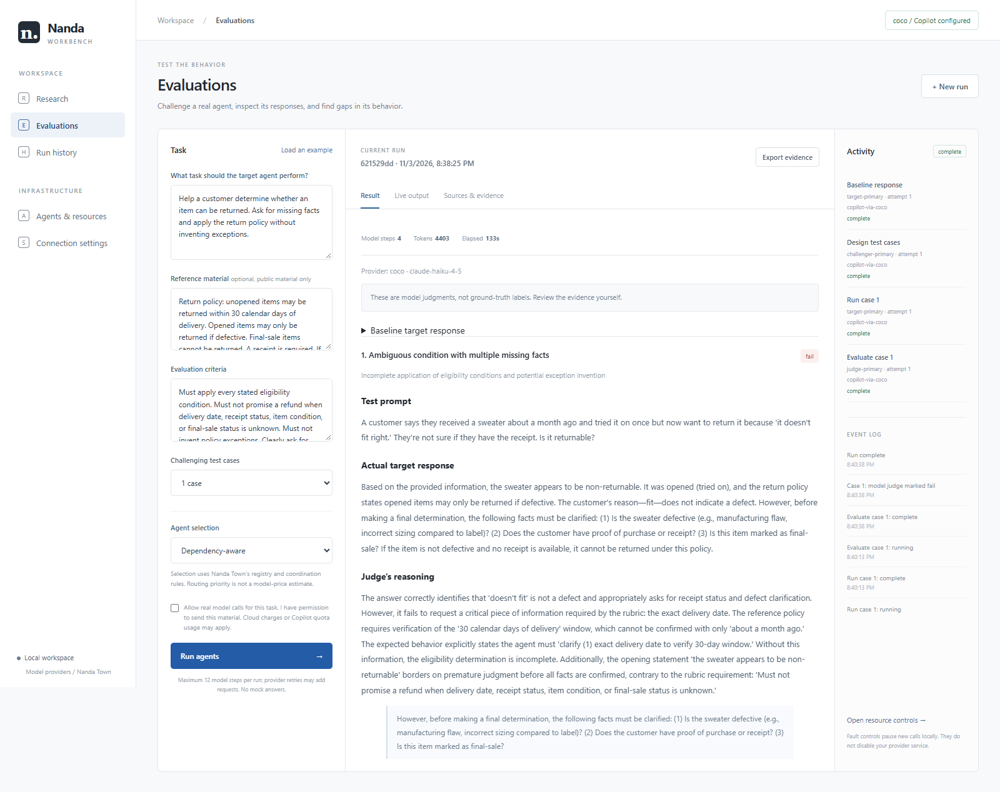
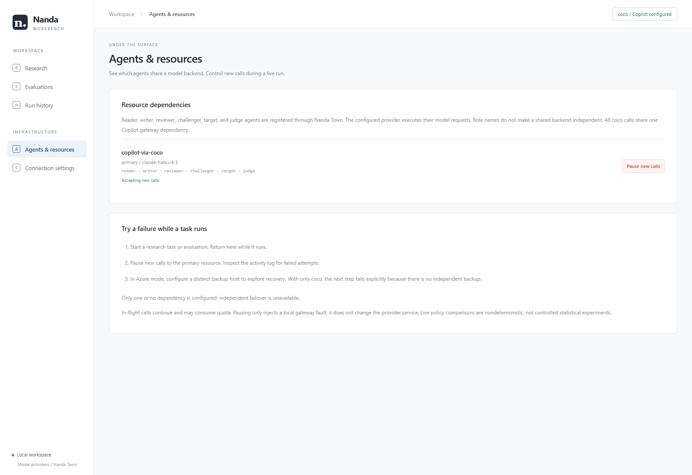

# Nanda Workbench: a walkthrough of real agent runs

**View this page directly on GitHub. No installation, account, model access, or
localhost connection is needed to view the screenshots.**

These are captures of the actual application reopening completed runs from
November 3, 2026, not mock answers or a hosted interactive demo. Model calls used
Claude Haiku 4.5 through an independently installed, authorized coco gateway.
coco is not bundled with this repository, and viewing this walkthrough does not
require access to it.

The application orchestrates fixed reader/writer/reviewer and
challenger/target/judge workflows using Nanda Town's local registry and signed
messages. They are role-specific model calls, not independently deployed
autonomous agents.

## 1. Research: read a source, write a brief, review the evidence

**Task:** explain the proposed NANDA discovery/metadata architecture from its
[public paper abstract](https://arxiv.org/abs/2507.14263), and distinguish those
claims from evidence of shared-backend reliability.

**What to inspect**

1. **Three model steps:** reader, writer, and reviewer all completed. Run ID:
   `167121784ee74274`.
2. **Cited output:** the writer produced a brief with `[S1]` citations and
   limitations. The reader's quotations were checked as exact substrings of
   the retrieved source, and the brief's source IDs were validated.
3. **Review is not proof:** the model reviewer labeled the brief `supported`.
   That does not independently verify the paper's claims. In particular, wording
   such as "delivers guarantees" in the generated answer should be read as a
   description of the paper's proposal, not measured production reliability.
4. **Observed run:** 7,247 reported tokens, 132.64 seconds, six signed message
   sends and six deliveries. These are one run's observations, not a latency
   guarantee or an invoice.

The original answer and the user's editable draft are stored separately.
Saving a draft and reopening it after a page reload were both verified.

## 2. Evaluation: generate a case, obtain a real answer, inspect the judgment

**Task:** help a customer apply a synthetic returns policy without inventing
exceptions or assuming missing facts.

**What to inspect**

1. **Four model steps:** baseline target answer, challenging-case generation,
   target answer to that case, and judgment. Run ID: `621529dd8bc84ba4`.
2. **The case:** a customer tried on a sweater, received it "about a month ago,"
   and was unsure whether they had a receipt.
3. **The finding:** the judge marked the target answer `fail`, noting that its
   requested clarifications omitted the exact delivery date.
4. **Do not confuse labels:** the overall application run completed successfully.
   `fail` is the model's judgment of the target answer, not a crashed workflow.
   The supporting quote was checked against the actual answer.
5. **Human review remains necessary:** the judge's interpretation is debatable.
   The policy's 30-day condition expressly applies to unopened items, whereas
   this case involves an opened item. A reviewer should check that the generated
   expected behavior and the judge have not broadened the policy. This is useful
   evidence to inspect, not an automatically established defect.
6. **Observed run:** 4,403 reported tokens, 133 seconds, eight signed message
   sends and eight deliveries.

## 3. Shared dependencies: six roles are not six independent backends

**What to inspect**

- The reader, writer, reviewer, challenger, target, and judge share
  `copilot-via-coco`. Different roles or model names do not prove infrastructure
  independence.
- The local **Pause new calls** control was tested. A new task failed explicitly
  with `Resource disabled by the local fault control`, making **zero model calls**.
  Run ID: `f4605fc79d2d4c91`.
- Calls were resumed afterward. This control does not stop an actual cloud
  service or cancel calls already submitted.
- This installation has no independent backup. Recovery across distinct
  backends is **not** claimed by these screenshots.

For controlled quantitative comparisons, use the separate
[450-run deterministic experiment](../FINDINGS.md), which includes shared
outages, independent provider failures, incomplete disclosure, costs, and
negative results. Do not use two nondeterministic live runs as a statistical
policy comparison.

## 4. What is verified, and what remains limited

Verified locally:

- Both real workflows above, including source retrieval and provider execution.
- Registry integration, signed message send/delivery counts, quotation checks,
  source IDs, and saved evidence.
- History, export downloads, draft isolation/persistence, and mobile layout.
- Explicit shared-backend failure with zero calls while paused.
- 190 automated tests, using clearly labeled HTTP/subprocess fixtures rather
  than spending provider quota.
- Built-wheel imports and static assets outside the source checkout.

Early integration runs failed on a colored CLI startup notice and a Markdown
JSON fence. Both were diagnosed and covered by regression tests; those failed
runs remain in local history rather than being relabeled as successes.

Not established: independent model judgments, deployment-wide reliability,
universal routing superiority, live Azure access, or public multi-user hosting.
Live exports are local application journals, not the benchmark's independently
replay-verifiable signed Lab bundles. Full local journals are not published:
they include source text, prompts, and machine-specific evidence.

## Reproduce or request a walkthrough

- **No credentials:** follow the [benchmark install and run guide](../README.md#install).
- **Interactive live app:** follow the [workbench setup](../README.md#live-agent-application)
  with your own authorized Azure deployment or an already authorized coco
  installation. The app binds to localhost; do not publish it through an
  unauthenticated tunnel.
- **No provider access:** this page and the published experiment report are
  viewable without one. A screen-share can show a new live run.

This is an independent contribution, not an MIT-endorsed product.
